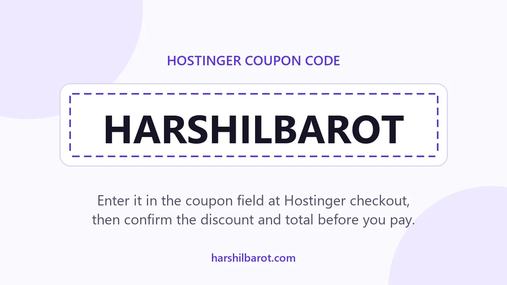
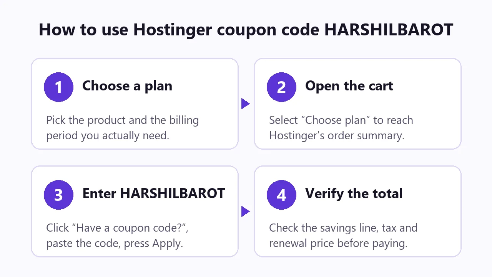
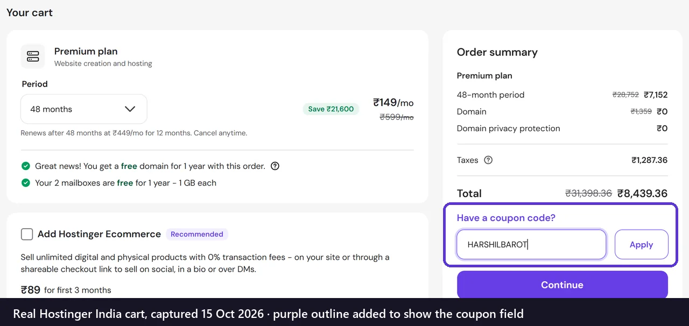
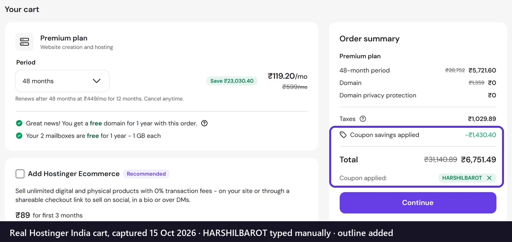
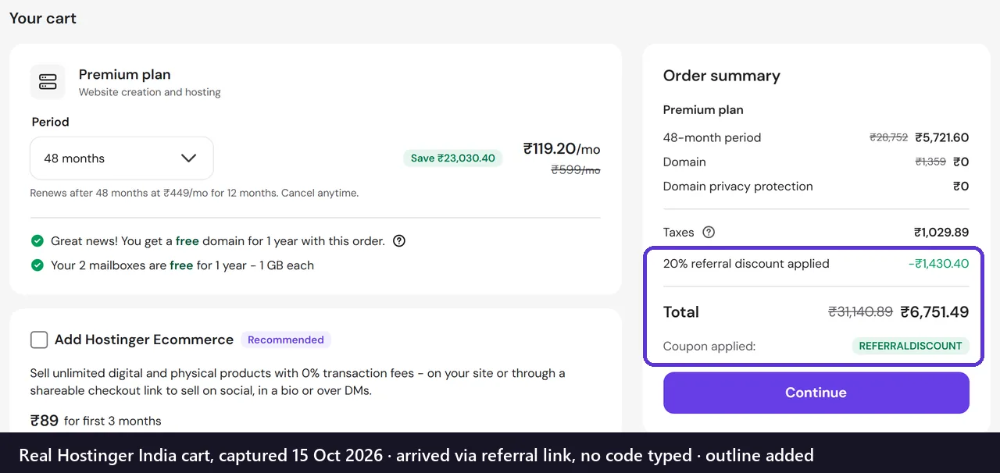

# Hostinger Coupon Code 2026 — HARSHILBAROT



**Quick answer:** the Hostinger coupon code is **`HARSHILBAROT`**. Type it under *Have a coupon code?* in Hostinger's order summary. In live carts checked on **15 October 2026**, it took **20% off the first-term price** of new web hosting and VPS plans, in rupees and US dollars. You can also open Hostinger through the referral link below, which applies the same 20% automatically.

**Hostinger coupon code — copy it from the box below:**

```text
HARSHILBAROT
```

**[Apply Hostinger coupon →](https://www.hostinger.com/in?REFERRALCODE=HARSHILBAROT)** — opens Hostinger's India storefront with the 20% referral discount attached.

> **Disclosure:** this is a Hostinger partner referral link. If you buy through it, I may earn a commission at no extra cost to you. Hostinger's landing page for the link reads "In partnership with Apzom Digital".

| Detail | What was verified on 15 Oct 2026 |
|---|---|
| Coupon | `HARSHILBAROT` |
| Provider | Hostinger |
| Discount | 20% off the first billing term of a new plan |
| Where to enter it | Cart → Order summary → *Have a coupon code?* → Apply |
| Through the referral link | Applied automatically, shown as "20% referral discount applied" |
| Not covered | Renewals and products you already own (per Hostinger) |
| Combining | One coupon per order; no extra saving from using link + code |
| Before paying | Check the savings line, tax, billing period and renewal price |

**Prefer a page with a one-click copy button?** Use the [Hostinger coupon landing page](https://apzomdigital.github.io/Hostinger-Coupon/).

---

## Contents

- [How to use HARSHILBAROT](#how-to-use-harshilbarot)
- [Where the coupon field is](#where-the-coupon-field-is)
- [Does it apply automatically?](#does-it-apply-automatically)
- [Checkout test results](#checkout-test-results)
- [WordPress, cloud and VPS](#wordpress-cloud-and-vps)
- [India pricing and GST](#india-pricing-and-gst)
- [Renewal pricing](#renewal-pricing)
- [Coupon vs sale vs referral](#coupon-vs-sale-vs-referral)
- [Coupon not working?](#coupon-not-working)
- [FAQs](#faqs)
- [My Hostinger experience](#my-hostinger-experience)

## How to use HARSHILBAROT

1. Open Hostinger, through the [referral link](https://www.hostinger.com/in?REFERRALCODE=HARSHILBAROT) or directly.
2. Choose the plan you need: web hosting, cloud, VPS and so on.
3. Pick the billing period. It sets both the upfront payment and when renewal starts.
4. In the cart, select **Have a coupon code?** in the order summary. If the field is missing, check for a "referral discount applied" line: the discount is already there.
5. Enter `HARSHILBAROT` and press **Apply**.
6. Confirm the **Coupon savings applied** line, the total including tax, and the renewal price before paying.



## Where the coupon field is

The field sits in the **Order summary** panel on the right of Hostinger's cart, under the total. It only appears after you select the purple *Have a coupon code?* link.



*Real Hostinger India cart (Premium, 48 months), captured 15 Oct 2026. The purple outline was added.*

After you press Apply, a **Coupon savings applied** line appears and the code shows under the total. In this cart the total including tax went from **₹8,439.36 to ₹6,751.49**.



*Same cart after applying HARSHILBAROT. Real screenshot, outline added.*

## Does it apply automatically?

**Through the referral link, yes.** Hostinger's partner landing page says the discount is "already applied to your first term". The cart then shows **"20% referral discount applied"** with the coupon listed as `REFERRALDISCOUNT`, and no code is typed. Going to Hostinger directly needs the code typed by hand.

Both routes gave the same Premium 48-month total in testing (₹6,751.49), so using the link *and* the code doesn't double the discount. Hostinger's page also says the link discount stays available for 7 days.



*Real Hostinger India cart reached through the referral link, 15 Oct 2026. No code was typed; outline added.*

## Checkout test results

All figures are first-term plan prices before tax, checked on 15 October 2026. They're snapshots: your own cart is the only reliable price.

| Cart | Without code | With HARSHILBAROT | Saving |
|---|---|---|---|
| India · Premium web hosting · 48 months | ₹7,152 | ₹5,721.60 | ₹1,430.40 (20%) |
| India · KVM 1 VPS · 24 months | ₹14,376 | ₹11,500.80 | ₹2,875.20 (20%) |
| US$ · Unlimited web hosting · 48 months | $191.52 | $153.22 | $38.30 (20%) |

## WordPress, cloud and VPS

- **WordPress hosting:** Hostinger's web hosting plans list WordPress as a build option, and the web hosting carts above accepted the code. The discount follows the plan, not what you install on it.
- **Cloud hosting:** the Cloud Startup card on Hostinger's referral plan page showed "Includes partner 20% off". It wasn't checked out separately.
- **VPS:** confirmed. A KVM 1 cart accepted HARSHILBAROT. VPS renewal terms differ from web hosting: KVM 1 listed ₹999/mo for 2 years at renewal.
- **Domains only:** not tested. Don't assume a standalone domain order is discounted.

## India pricing and GST

The referral link opens **hostinger.com/in**. Prices there are in rupees and listed **without GST**. In the Premium test cart, tax was 18% of the discounted plan price.

The code isn't India-only: it also worked on the US-dollar storefront.

| Plan (48 months, 20% applied, before GST) | Monthly equivalent | Paid upfront | Renews at |
|---|---|---|---|
| Single | ₹55.20 | ₹2,649.60 | ₹289/mo |
| Premium | ₹119.20 | ₹5,721.60 | ₹449/mo |
| Unlimited | ₹199.20 | ₹9,561.60 | ₹649/mo |
| Cloud Startup | ₹479.20 | ₹23,001.60 | ₹1,599/mo |

## Renewal pricing

The coupon lowers the **first term only**. For Premium, the cart reads "renews after 48 months at ₹449/mo for 12 months". That's roughly **3.8×** the discounted ₹119.20, and a single 12-month renewal (₹5,388 before GST) costs nearly as much as the whole four-year first term. The free domain and mailboxes on Premium last one year, not four. Budget for renewal before choosing a plan or a long term.

## Coupon vs sale vs referral

- **Sale price:** the reduced price shown to everyone (Premium ₹149/mo vs a ₹599/mo list price). No code is needed.
- **Coupon code:** HARSHILBAROT takes 20% off the *sale* price (₹149 → ₹119.20).
- **Referral discount:** the same 20%, attached automatically by the link.
- **Introductory vs renewal:** the first term carries the discounts; renewals don't.

Sale and coupon percentages don't add up: "75% off" plus "20% off" isn't 95% off. Judge the offer by the cart total after tax, which also depends on the billing period, any add-ons ticked and your currency.

## Coupon not working?

1. **Check for an existing discount.** A "referral discount applied" line or another code under *Coupon applied* means the order already has one, and Hostinger allows one per order.
2. **Check the spelling.** It's `HARSHILBAROT`: twelve letters, no spaces.
3. **Check it's a new purchase.** Hostinger excludes renewals and products you already own.
4. **Check the product and billing period** you actually intend to buy.
5. **Check your storefront and currency.** Regional prices differ.
6. **Allow for change.** Promotions can end or change after 15 Oct 2026.
7. **Contact Hostinger support** if an eligible new plan still won't accept it.

## FAQs

**What is the best Hostinger coupon code?**
`HARSHILBAROT` gave 20% off the first term in every cart tested on 15 Oct 2026. Account-specific or seasonal offers can differ, so compare cart totals.

**Can existing Hostinger customers use it?**
Hostinger says the 20% covers the first term of any *new* plan and excludes renewals and existing purchases. It wasn't tested on an existing account, so add the plan to your cart and check for the savings line.

**Is it for new customers?**
Yes. Every test cart was built as a new visitor and accepted it.

**Can I combine Hostinger coupons?**
No, it's one coupon per order.

**Does Hostinger offer Black Friday coupons?**
Hostinger runs seasonal campaigns, but no 2026 Black Friday price has been verified here, and it's unknown whether this code will combine with one.

**What happens at renewal?**
You pay Hostinger's regular renewal price. The coupon doesn't apply.

**Is there a money-back guarantee?**
The cart advertises 30 days. Read Hostinger's refund policy for exclusions, such as domains.

## My Hostinger experience

I've used Hostinger personally for about seven years, and my current editorial rating is **4.8/5**. That's my opinion from long-term use, not an average of customer reviews or a performance guarantee.

**[Read my complete Hostinger Coupon Code guide](https://harshilbarot.com/hostinger-coupon-code/)** for the fuller account: plan-by-plan advice, who should skip the deal, and how I judge renewals.

---

## Ready to use the coupon?

1. Copy `HARSHILBAROT` (from the box at the top, or [the landing page with a copy button](https://apzomdigital.github.io/Hostinger-Coupon/)).
2. **[Visit Hostinger with the 20% applied →](https://www.hostinger.com/in?REFERRALCODE=HARSHILBAROT)**
3. Before paying, compare your cart total and renewal price with the figures above.

<sub>Written by Harshil Barot. Prices and coupon behaviour were last checked in live Hostinger carts on 15 October 2026 and can change. Hostinger is a trademark of its owner. This repository is an independent guide using Hostinger partner referral links, and it isn't operated by Hostinger. Screenshots show Hostinger's checkout to explain where the coupon goes.</sub>
